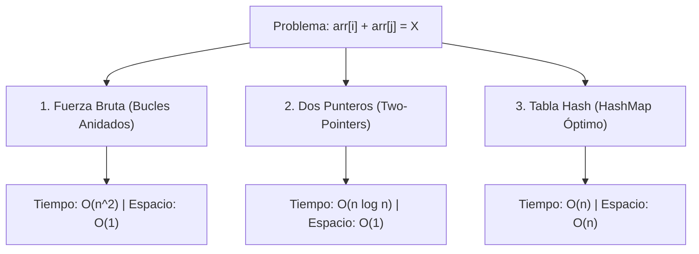

# Algoritmo Two-Sum y Búsqueda de Pares en Arreglos en Java

[](https://www.oracle.com/java/)
[](https://en.wikipedia.org/wiki/Subset_sum_problem)
[](LICENSE)

Implementación y análisis algorítmico en **Java** del problema clásico de **Two-Sum (Suma de Dos Elementos en un Arreglo)** propuesto en el concurso de programación de la Universidad de los Andes: *Dado un arreglo de enteros y un valor objetivo $X$, retornar dos índices $i$ y $j$ tales que $arr[i] + arr[j] = X$*.

---

## 📐 Análisis de Complejidad y Estrategias Algorítmicas

El problema Two-Sum es uno de los problemas fundamentales en ciencias de la computación para ilustrar las compensaciones de costo computacional entre tiempo de ejecución (*Time Complexity*) y consumo de memoria (*Space Complexity*):



---

### 1. Enfoque por Fuerza Bruta ($O(n^2)$)

Implementado directamente en la función `solve(int arreglo[], int x)` del repositorio:

```java
static String solve(int arreglo[], int x) {
    String rta = "No se llegó a una solución";
    for (int i = 0; i < arreglo.length; i++) {
        for (int j = 0; j < arreglo.length; j++) {
            if (arreglo[i] + arreglo[j] == x) {
                rta = "Se encontró la solución en los indices " + i + " y " + j;
                return rta;
            }
        }
    }
    return rta;
}
```

- **Complejidad Temporal**: $O(n^2)$ comparaciones en el peor caso.
- **Complejidad Espacial**: $O(1)$ memoria adicional constante.

---

### 2. Enfoque Alternativo Óptimo con Tabla Hash ($O(n)$)

En aplicaciones de producción con arreglos de gran tamaño ($n \ge 10^5$), el problema se optimiza en tiempo lineal $O(n)$ almacenando el complemento $X - arr[i]$ en un `HashMap<Integer, Integer>`:

```java
public static int[] twoSumHash(int[] nums, int target) {
    Map<Integer, Integer> map = new HashMap<>();
    for (int i = 0; i < nums.length; i++) {
        int complement = target - nums[i];
        if (map.containsKey(complement)) {
            return new int[] { map.get(complement), i };
        }
        map.put(nums[i], i);
    }
    return null;
}
```

---

## 📂 Estructura del Proyecto

```text
arreglos-andes/
├── src/
│   └── andes/
│       └── Andes.java       # Implementacion principal con entrada interactiva (Scanner / JOptionPane)
├── build.xml                # Archivo de construccion para Apache Ant
└── manifest.mf              # Manifiesto JAR
```

---

## 🚀 Requisitos y Compilación

### Prerrequisitos

- **Java Development Kit (JDK)** versión 8 o superior.

### Compilación y Ejecución Manual

```bash
# Compilar el código fuente
javac -d bin src/andes/Andes.java

# Ejecutar el programa
java -cp bin andes.Andes
```

El programa permite ingresar los 10 elementos del arreglo y el número objetivo $X$, retornando inmediatamente los índices que satisfacen la suma.

---

## 📄 Licencia

Distribuido bajo la Licencia MIT. Consulta el archivo `LICENSE` para más información.
